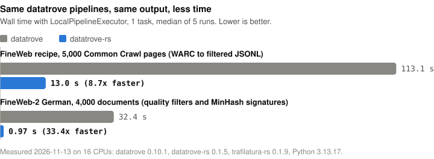

# datatrove-rs

[](https://pypi.org/project/datatrove-rs/)
[](https://pypi.org/project/datatrove-rs/)
[](https://github.com/Hexay/datatrove-rs/actions/workflows/ci.yml)
[](https://github.com/Hexay/datatrove-rs/blob/master/LICENSE)

Rust implementations of the slow steps in [datatrove](https://github.com/huggingface/datatrove) pipelines.

- **Drop-in.** Each step subclasses the datatrove step and takes the same arguments. Set `DATATROVE_RS=1` and an
  unchanged pipeline uses them.
- **Exact.** Keep/drop decisions, drop reasons, rewritten text, stats, and MinHash, sentence-dedup and Bloom filter
  files are byte-identical to datatrove's.
- **Safe fallback.** Anything not verified (a language, a document, an option, a dependency version) runs datatrove's
  own code.

<p align="center">
  
</p>

## Installation

```bash
pip install "datatrove-rs[trafilatura]"
```

The `[trafilatura]` extra adds [trafilatura-rs](https://github.com/Hexay/trafilatura-rs) for the `Trafilatura`
extractor, the most expensive step of the FineWeb recipe; every other step is accelerated without it.

Requires Python 3.10+ and datatrove `>=0.10.1,<0.11`. Wheels (abi3) are built for Linux x86_64/aarch64, macOS
x86_64/arm64 and Windows x64.

## Quickstart

```bash
DATATROVE_RS=1 python my_pipeline.py      # or: python -m datatrove_rs my_pipeline.py
```

Or in code:

```python
import datatrove_rs
datatrove_rs.patch()  # datatrove's own imports now return the Rust-backed steps

# or import from the mirror: any `datatrove.X` module is available as `datatrove_rs.X`
from datatrove_rs.pipeline.filters import GopherQualityFilter, URLFilter
```

Executor workers inherit the variable, and pickled steps refer to the `datatrove_rs` classes, so local and Slurm
workers run the same steps either way.

## Coverage and speed

Single-thread speedup over datatrove on the same documents.

| Step | English | Other languages |
|---|---:|---|
| `extractors.Trafilatura` | 9.8x | |
| `readers.WarcReader` | 2.2x | |
| `filters.URLFilter` | 7x | |
| `filters.LanguageFilter` | 1.3x | |
| `filters.GopherRepetitionFilter` | 79x | |
| `filters.GopherQualityFilter` | 65x | |
| `filters.C4QualityFilter` | 58x | th 6.7x, ur 1.9x |
| `filters.FineWebQualityFilter` | 77x | |
| the four quality filters, chained | 68x | de 53x, zh 33x, vi 31x, hi 16x, th 8.9x, ja 4.5x |
| `filters.C4BadWordsFilter` | 13x | FineWeb-2 13x |
| `filters.UnigramLogProbFilter` | 60x | de 50x, zh 27x |
| `dedup.MinhashDedupSignature` | 47x | de 45x, vi 40x, zh 28x, hi 5.7x, th 5.3x, ja 4.2x |
| `dedup.MinhashDedupCluster` | 14-24x | |
| `dedup.SentenceDedupSignature` | 69x | de 52x, zh 24x, th 6.9x, ur 5.6x, hi 4.1x |
| `dedup.SentenceDedupFilter` | 105x | de 83x, zh 38x, th 7.4x, ur 4.0x, hi 1.8x |
| `dedup.SingleBloomFilter` | 37x | de 30x, zh 20x |
| `decont.NGramsDecontFilter` | 53x | de 35x, zh 16x |
| `formatters.FTFYFormatter` | 34x | FineWeb-2 25-74x (garbled text 9-29x) |
| `formatters.PIIFormatter` | 16x | FineWeb-2 9x |
| `stats.WordStats` | 27x | de 31x, zh 20x, hi 2.0x |
| `stats.SentenceStats` | 43x | de 54x, zh 28x, th 8.3x, ur 5.8x, hi 2.5x |
| `stats.DocStats` | 6x | de 8x, zh 3.6x, hi 3.6x |
| `stats.LineStats`, `stats.ParagraphStats` | 2-3x | 1.5-3.9x |

Notes:

- `Trafilatura` is step time inside the FineWeb recipe and needs the `[trafilatura]` extra. `WarcReader`,
  `URLFilter` and `LanguageFilter` are CPU time on 5,000 Common Crawl records. Most of `URLFilter`'s time is
  blocklist loading and tldextract setup, and most of `LanguageFilter`'s is fastText inference.
- `MinhashDedupCluster` is CPU time on 37M pairs; peak RSS is 350 MB against datatrove's 829-1,015 MB.
- `NGramsDecontFilter` also covers `NGramsDecontIndexer.compute_hashes`. `SingleBloomFilter` is timed on `step()`.
- The stats steps run in Rust with datatrove 0.10.1 only.

Sources: the English column was measured on 2026-11-13 with 0.1.5 using `tools/bench.py`, except `WarcReader`,
`URLFilter` and `LanguageFilter`
([#1](https://github.com/Hexay/datatrove-rs/pull/1)), and `MinhashDedupCluster`, `PIIFormatter`, `FTFYFormatter`
and `C4BadWordsFilter` ([#2](https://github.com/Hexay/datatrove-rs/pull/2)). The other languages come from the pull
request that added each one: German [#3](https://github.com/Hexay/datatrove-rs/pull/3), Japanese
[#5](https://github.com/Hexay/datatrove-rs/pull/5), Indic [#6](https://github.com/Hexay/datatrove-rs/pull/6), stats
[#7](https://github.com/Hexay/datatrove-rs/pull/7), Bloom, decontamination and unigram
[#8](https://github.com/Hexay/datatrove-rs/pull/8), sentence dedup [#9](https://github.com/Hexay/datatrove-rs/pull/9),
FTFY [#11](https://github.com/Hexay/datatrove-rs/pull/11), Thai [#12](https://github.com/Hexay/datatrove-rs/pull/12)
and Urdu [#13](https://github.com/Hexay/datatrove-rs/pull/13).

### Languages

The steps that tokenize (filters, MinHash stage 1, stats, sentence dedup, Bloom, decontamination, unigram) run in
Rust for:

- the 57 languages spaCy tokenizes with rules (English, German, French, Spanish, Russian, Italian, Portuguese,
  Polish, Dutch, Turkish, Indonesian, 45 more, and the multi-language `xx`);
- Chinese (jieba) and Japanese (SudachiPy);
- Vietnamese (pyvi) and Thai (pythainlp `newmm` words, `crfcut` sentences);
- the 16 Indic NLP tokenizers datatrove uses for 129 language keys (Hindi, Bengali, Tamil, Urdu and more).

## What runs datatrove's code

- Korean (Kiwi), Stanza languages, and datatrove's whitespace, Burmese, Tibetan, Lao and Khmer tokenizers.
- Urdu sentence splitting, unless urduhack 1.0.2 or 1.0.3 is installed and importable. Every urduhack release after
  0.1.4 pins Click 7, which conflicts with spaCy, so `pip install "datatrove[multilingual]"` resolves 0.1.4. With
  0.1.4, Urdu sentences run datatrove's code.
- Urdu and Indic documents whose sentences datatrove can't locate in the text. datatrove raises on these
  ([huggingface/datatrove#582](https://github.com/huggingface/datatrove/issues/582)), and so does datatrove-rs.
- `FTFYFormatter` with ligature, width, quote or line-break fixing or a normalization enabled. In that case Rust only
  skips ftfy on documents it provably leaves unchanged.
- Documents containing the token `IS_ALPHA` while spaCy is installed: spaCy's output on them depends on process
  history ([docs/is-alpha.md](https://github.com/Hexay/datatrove-rs/blob/master/docs/is-alpha.md)).
- Documents with lone surrogates.
- Steps whose dependency is at an unverified version (below), and subclasses that override a reproduced method.
- Options outside the reproduced set, such as Trafilatura options trafilatura-rs doesn't support, non-default PII
  patterns, or `URLFilter` without the integrated lists.

The fallback is decided at run time, per language, per document or per step. The full list is in
[docs/parity.md](https://github.com/Hexay/datatrove-rs/blob/master/docs/parity.md).

## Exactness and version guards

Each step is checked against unmodified datatrove in the same environment. The comparison is byte for byte and covers
per-document results, rewritten text, `run()` stats, exclusion-writer documents and output files. It runs on real
FineWeb and FineWeb-2 documents plus perturbed and fuzzed ones, in every covered language. Corpora, configurations and
results are in [docs/parity.md](https://github.com/Hexay/datatrove-rs/blob/master/docs/parity.md).

Where output depends on another library's version, the installed version is checked at run time. On a mismatch, the
affected step or language runs datatrove's code:

| Dependency | Rust path only when |
|---|---|
| datatrove | 0.10.1 for the stats steps; sentence dedup checks a fingerprint of the methods it reproduces |
| spaCy | 3.8.2-3.8.11 or 3.8.13-3.8.18 (tokenizer rules identical to the shipped ones), or not installed |
| jieba | 0.42.1 |
| SudachiPy | 0.7.0 with SudachiDict-core |
| pyvi, pythainlp, indic-nlp-library | 0.1.1, 5.4.0, 0.92, or not installed |
| python-crfsuite | 0.9.12 with pythainlp 5.4.0 (Thai sentences) |
| urduhack | 1.0.2 or 1.0.3, importable (it needs TensorFlow), for Urdu sentences |
| trafilatura, lxml | a pair trafilatura-rs reproduces |
| tldextract | 5.4.x (otherwise only the host split runs in tldextract) |
| ftfy | 6.3.1 for the `fix_text` port; other 6.x only skips unchanged documents |

The Unicode tables come from Python 3.13 (Unicode 15.1). On another Unicode version the package warns on import,
because results could differ on rare characters.

## Benchmarks

`tools/recipe_bench.py` produces the chart. It runs each pipeline through `LocalPipelineExecutor` (1 task),
alternating datatrove and datatrove-rs runs and comparing output digests. `tools/make_chart.py` draws the chart from
the raw runs in [docs/assets/fineweb-speed.json](https://github.com/Hexay/datatrove-rs/blob/master/docs/assets/fineweb-speed.json).
The 2026-11-13 runs were on a shared 16-CPU machine at load average 8-36. Each run is single-threaded, its CPU time is
within 4% of its wall time, and no run was memory-throttled.

`tools/bench.py` produces the per-step numbers: one thread, the step alone, median of 3. Per-language tables and
profiling are in [docs/fineweb-profile.md](https://github.com/Hexay/datatrove-rs/blob/master/docs/fineweb-profile.md)
and the linked pull requests.

## Contributing

Development setup, the parity harness, benchmarks and releasing are covered in
[CONTRIBUTING.md](https://github.com/Hexay/datatrove-rs/blob/master/CONTRIBUTING.md). Bugs found in upstream projects
along the way are tracked in [docs/upstream-issues.md](https://github.com/Hexay/datatrove-rs/blob/master/docs/upstream-issues.md).

## License

Apache-2.0, like datatrove. datatrove-rs is an independent project and is not affiliated with Hugging Face.
