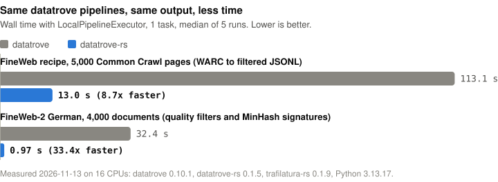

# datatrove-rs

[](https://pypi.org/project/datatrove-rs/)
[](https://pypi.org/project/datatrove-rs/)
[](https://github.com/Hexay/datatrove-rs/actions/workflows/ci.yml)
[](LICENSE)

Rust implementations of the hot steps in [datatrove](https://github.com/huggingface/datatrove) pipelines, with
**byte-identical output**. Turn it on with one environment variable, keep your pipeline code as it is, and the
FineWeb recipe runs about 5x faster.

<p align="center">
  
</p>

## Installation

```bash
pip install "datatrove-rs[trafilatura]"
```

The `[trafilatura]` extra adds [trafilatura-rs](https://github.com/Hexay/trafilatura-rs) for HTML extraction, which
is where most of the recipe's time goes. Leave the extra off to accelerate only the filters and MinHash.

Requires Python 3.10+ and datatrove `>=0.10.1,<0.11`. Wheels are built for Linux, macOS and Windows.

## Quickstart

Your existing pipeline, unchanged:

```bash
DATATROVE_RS=1 python my_pipeline.py
```

That's it. Any step datatrove-rs covers runs in Rust; every other step runs datatrove's own code. The switch also
reaches executor worker processes.

Prefer it in code? Either of these works too:

```python
import datatrove_rs
datatrove_rs.patch()  # datatrove's own imports now return the Rust-backed steps

# or import from the mirror: any `datatrove.X` module is available as `datatrove_rs.X`
from datatrove_rs.pipeline.filters import GopherQualityFilter, URLFilter
```

You can also run a script unmodified with `python -m datatrove_rs my_pipeline.py`.

## What's accelerated

| datatrove step | Speedup | Notes |
|---|---:|---|
| `extractors.Trafilatura` | ~7x | via trafilatura-rs, with the `[trafilatura]` extra |
| `filters.GopherRepetitionFilter` | 87x | |
| `filters.GopherQualityFilter` | 79x | |
| `filters.C4QualityFilter` | 49x | |
| `filters.FineWebQualityFilter` | 86x | |
| `dedup.MinhashDedupSignature` | 48x | MinHash stage 1 |

Filter and MinHash speedups are single-thread throughput on 1,000 FineWeb documents. Trafilatura's is inside the
full pipeline. Full numbers and method: [docs/fineweb-profile.md](docs/fineweb-profile.md).

Each replacement subclasses the datatrove step, takes the same arguments and produces the same results: keep/drop
decisions, drop reasons, rewritten text, stats and MinHash signature files. Pickled pipelines work on Slurm and
local multiprocessing workers whether or not the worker patched.

## Exactness

Output equality with datatrove is the product, so every change is checked against unmodified datatrove:

- **Filters and MinHash:** 10,500 real, perturbed and fuzzed documents across 26 configurations, 0 mismatches. The
  spaCy-compatible tokenizer matches spaCy on 9.7M tokens.
- **Trafilatura:** 10,666 of 10,666 Common Crawl pages identical (see trafilatura-rs).
- **End to end:** the FineWeb recipe gives identical output on 5,000 Common Crawl records.

When the Rust path can't guarantee identical results, the step falls back to datatrove's own code for that case.
This applies to non-English languages and to Trafilatura options trafilatura-rs doesn't cover. Details and
reproduced quirks are in [docs/parity.md](docs/parity.md).

## Contributing

Development setup, the parity harness, benchmarks and releasing: [CONTRIBUTING.md](CONTRIBUTING.md).

## License

Apache-2.0, like datatrove. datatrove-rs is an independent project and is not affiliated with Hugging Face.
